### Tentang Saya

- Mahasiswa Informatika di **Universitas Muhammadiyah Makassar**
- Sedang belajar pemrograman dan eksplorasi teknologi
- Terhubung dengan saya di [LinkedIn](https://www.linkedin.com/in/alamsyah-sahlan-896094444/)

### Tools & Bahasa

  

### GitHub Stats

  
  

